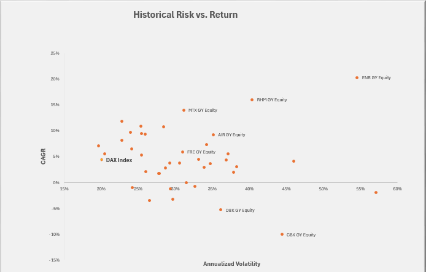

DAX Stock Performance Analysis

📊 Project Overview

This project analyzes the historical performance and risk characteristics of DAX\-listed equities using Microsoft Excel.

The analysis transforms historical market data into a structured set of performance and risk metrics, allowing individual stocks to be evaluated and compared against the DAX benchmark.

📉 Analysis Preview

Historical Risk vs. Return

🔎 Key Insights

| Insight | Security | Evidence |
| --- | --- | --- |
| **Strongest long-term growth** | RHM | 16.0% CAGR across 300 monthly return observations, with **40.4% annualized volatility** |
| **Strong risk-return profile** | DB1 | 10.9% CAGR, **25.3% volatility**, and **8.5% annualized alpha** across 286 observations |
| **Lowest market sensitivity** | BEI | Beta of **0.27**, DAX correlation of **0.28**, and **19.7% annualized volatility** |
| **Highest observed growth** | ENR | Highest CAGR at **20.3%**, but with **54.5% volatility** and only 51 observations |
| **Weakest long-term performance** | CBK | **-10.0% CAGR**, **44.4% volatility**, and beta of **1.44** |

Benchmark context: The DAX recorded approximately 4.3% CAGR and 20.0% annualized volatility over 300 monthly return observations.

🎯 Objectives

The project explores several key questions:

- How have individual DAX stocks performed historically?
- Which stocks generated the highest and lowest monthly returns?
- How does risk differ across the selected equities?
- How strongly are individual stocks correlated with the DAX?
- How sensitive is each stock to movements in the broader market?
- How does risk\-adjusted performance vary across companies?
  
📈 Metrics Analyzed

The Excel model calculates:

- Average Monthly Return
- Annualized Arithmetic Return
- Annualized Volatility
- Best Monthly Return
- Worst Monthly Return
- Compound Annual Growth Rate (CAGR)
- Correlation with the DAX
- Beta
- Alpha
- Annualized Alpha
- R²

🛠️ Excel Skills Demonstrated

This project demonstrates practical Excel skills including:

- Excel Tables and structured references
- Financial return calculations
- AVERAGEIFS and COUNTIFS
- Correlation analysis
- Regression\-based Beta and Alpha calculations
- CAGR calculations
- Annualization of returns and volatility
- Benchmark comparison
- Data organization and transformation
- Financial data visualization

📁 Workbook Structure

**Source Data Table**

Contains the historical market data and monthly return calculations used in the analysis.

**Summary**

Consolidates the major performance and risk metrics for the analyzed securities.

**Benchmark Sheet**

Structures stock and DAX benchmark returns for comparative analysis.

**Stock vs. DAX Analysis**

Selected securities are visualized against the DAX benchmark to examine differences in historical performance.

💡 Purpose

This project was created as part of my development in business analytics and quantitative analysis. It demonstrates how Excel can be used not only for spreadsheet calculations, but also as a practical tool for financial data analysis, benchmarking, and communicating analytical results.

👤 Author

Andiee

MSC Business Analytics & Operations Research

